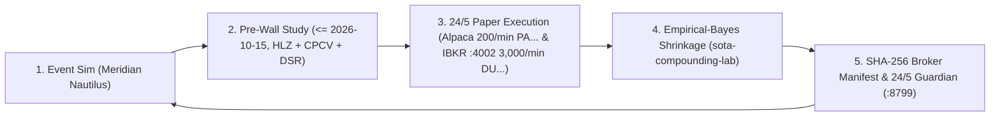

# Native Agent Stack (`github.com/native-agent-stack` — `v3.0.0`)

**Unified Multi-Model LLM-Native SOTA Harness, Causal Pre-Wall Quant Research & `24/5` Paper-Execution Ecosystem.**

Every active repository (`18/18`) enforces upstream-first provenance, MADR 4.0 Architecture Decision Records (`docs/adr/CATALOG.md`), isolated `git worktree` execution, `40`-char SHA-pinned GitHub Actions, and fail-closed privacy/trading gates (`scripts/merge_gate.py` + `sota-org-doctor --live`).

---

## 1. Three-Tier 22-Repository Organization Architecture

### A. Public Open-Core Tier (`9` Repos — Unlimited Free GitHub Actions CI, `40`-Char SHA Pins)
| Layer | Repository | Role & Verification Gate |
| :--- | :--- | :--- |
| **L0 Control Plane** | [`.github`](https://github.com/native-agent-stack/.github) | Org profile, 22-repo `ECOSYSTEM_ORG_MANIFEST.json`, `6` MADR 4.0 ADRs & reusable SHA-pinned CI |
| **L1 Umbrella Lock** | [`native-agent-stack`](https://github.com/native-agent-stack/native-agent-stack) | Pristine `<100 KB` `v3.0.0` Umbrella, Single-Owner Layer Bijection (`ECOSYSTEM_CONVERGENCE_LOCK.json`) & `5` ADRs |
| **L2 Shelf Lock** | [`sota-upstream-shelf-lock`](https://github.com/native-agent-stack/sota-upstream-shelf-lock) | `18` immutable `40`-char Git SHA upstream library pins & promotion validator |
| **L3 Core Foundation** | [`sota-harness-foundation`](https://github.com/native-agent-stack/sota-harness-foundation) | Open-core multi-runtime foundation, `20` MADR 4.0 ADRs & `Hypothesis` stateful fuzzing |
| **L4 AGY Harness** | [`agy-sota-harness`](https://github.com/native-agent-stack/agy-sota-harness) | Antigravity `L0–L12` harness, pre-wall DuckDB/Polars studies (`H02/H04/H06`), `14` ADRs & `13/13` probes |
| **L6 DSH Harness** | [`dsh-sota-harness`](https://github.com/native-agent-stack/dsh-sota-harness) | DeepSeek Harness `10`-layer probe suite, `3` MADR 4.0 ADRs & cross-peer MCP triad |
| **L7 Workflow Mesh** | [`sota-multi-model-workflows`](https://github.com/native-agent-stack/sota-multi-model-workflows) | `11` self-bootstrapping multi-model workflows (`v3.0.0`), SQLite WAL peer bus & `7` ADRs |
| **Stage 4 Compounding** | [`sota-compounding-lab`](https://github.com/native-agent-stack/sota-compounding-lab) | 5-stage `Sim -> PreWall -> Paper -> Empirical-Bayes -> Broker` engine + 4-invariant `sota-org-doctor` |
| **Stage 3B IBKR Lane** | [`astrolabe`](https://github.com/native-agent-stack/astrolabe) | IBKR `:4002` (`DU...` paper-only) `NautilusTrader` execution engine (`281/281` tree/gate tests) |

### B. Private Proprietary Execution, Simulation & Vault Tier (`9` Active Repos — `actions_enabled=false`, `0` Paid Quota Burn)
- `sota-mover-ranker` (`8` ADRs: `3.0s` `SIP+BOATS` whole-market radar `:8787` + `<= 200 req/min` Alpaca & `3,000 msg/min` IBKR paper auto-trader)
- `sota-dynamic-trail-c` (`4` ADRs: `v0.6.0` `24/5` sub-50ms `6–14 bps` Near-Lossless Scratch Shield & Dual-Tranche guardian `:8799`)
- `sota-private-vault` (`6` ADRs: `82`-trial HLZ ledger, `E1–E4` lessons, Empirical-Bayes priors & SHA-256 broker manifest)
- `cc-sota-harness` (`20` ADRs: `27`-runtime frontier sibling harness & `H05` tick microstructure pre-wall study)
- `meridian` (`50` ADRs: Stage-1 `NautilusTrader v2.0.0rc9` queue-fill parity simulation engine)
- `canon` (`149` ADRs: Stage-2 deterministic causal research & evaluation engine)
- `tsl` (`16` ADRs), `trading-sota` (`10` ADRs), `dsh-plugin-landscape` (`3` ADRs)

### C. Cold-Archived Superseded Tier (`4` Frozen `PRIVATE` Repos — `archived=true`, `actions_enabled=false`)
- `legacy-agent-stack-202610`, `legacy-edge-202611`, `legacy-movers-202611`, `ecosystem-records` (historical commits & PRs `#1–#1272` preserved in cold storage with `0` cron churn and `0` packfile bloat).

---

## 2. 5-Stage Compounding Strategy Lifecycle (`Sim -> Pre-Wall -> Paper -> Fine-Tune -> Broker`)

- **Hard Paper-Only Firewall:** Live real-money broker endpoints and live IBKR ports (`4001`, `7496`) are `100%` refused at runtime and CI (`ADR-0005`). Every paper order enforces `ADR-0022 <= 2.00%` initial stops.
