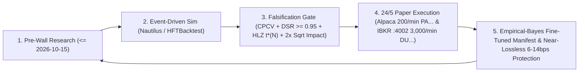

# Native Agent Stack (`github.com/native-agent-stack`)

**Unified Multi-Model LLM-Native SOTA Harness, Causal Pre-Wall Quant Research & `24/5` Paper-Execution Ecosystem.**

Every repository in `native-agent-stack` enforces upstream-first provenance (`UPSTREAM.md` + `upstream-map.toml`), MADR 4.0 GitHub-evidenced Architecture Decision Records (`docs/adr/CATALOG.md`), isolated git worktree execution, and fail-closed secret/privacy gates (`scripts/merge_gate.py` + `gitleaks`).

---

## 1. Two-Tier Organization Visibility Firewall

| Tier | Repository | Visibility | Purpose & CI Model |
| :--- | :--- | :--- | :--- |
| **Control Plane** | [`.github`](https://github.com/native-agent-stack/.github) | `PUBLIC` | Org profile, `ECOSYSTEM_ORG_MANIFEST.json`, MADR 4.0 governance & reusable SHA-pinned Actions |
| **Umbrella Catalog** | [`native-agent-stack`](https://github.com/native-agent-stack/native-agent-stack) | `PUBLIC` | Evidence-backed 861-repo convergence catalog & 8-shard validation suite |
| **Workflow Mesh** | [`sota-multi-model-workflows`](https://github.com/native-agent-stack/sota-multi-model-workflows) | `PUBLIC` | 9 LLM-native multi-model workflows (`AGY` / `Claude` / `Codex` / `DSH` / `Orca`), SQLite WAL peer-bus & Sim-to-Broker validator |
| **Compounding Lab** | [`sota-compounding-lab`](https://github.com/native-agent-stack/sota-compounding-lab) | `PUBLIC` | Open-core 5-stage `Sim -> PreWall -> Paper -> Empirical-Bayes -> Alpaca/IBKR` lifecycle validator |
| **Harness Core** | [`sota-harness-foundation`](https://github.com/native-agent-stack/sota-harness-foundation) | `PUBLIC` | Open-core multi-model routing, MADR 4.0 verifier & stateful Hypothesis fuzzing |
| **Upstream Lock** | [`sota-upstream-shelf-lock`](https://github.com/native-agent-stack/sota-upstream-shelf-lock) | `PUBLIC` | 40-char commit-SHA lock & drift auditor for all 18 pinned upstream trading libraries |
| **AGY Harness** | [`agy-sota-harness`](https://github.com/native-agent-stack/agy-sota-harness) | `PUBLIC` | Antigravity `L0–L12` harness, 14 MADR 4.0 ADRs & 13-layer deterministic probes |
| **DSH Harness** | [`dsh-sota-harness`](https://github.com/native-agent-stack/dsh-sota-harness) | `PUBLIC` | DeepSeek Harness cross-peer MCP preset & pre-wall trading firewall |
| **Mover Radar** | `sota-mover-ranker` | `PRIVATE` | `3.0s` `SIP+BOATS` whole-market radar (`:8787`), `200/min` Alpaca + `3,000/min` IBKR Paper execution |
| **Near-Lossless Trail** | `sota-dynamic-trail-c` | `PRIVATE` | `v0.6.0` `24/5` `6–14 bps` Mega-Cap Near-Lossless Scratch Shield, Dual-Tranche & `:8799` webhook |
| **Claude Fleet** | `cc-sota-harness` | `PRIVATE` | 24-runtime frontier multi-model sibling harness & internal H05 empirical lake audits |
| **Private Vault** | `sota-private-vault` | `PRIVATE` | Scrubbed `HYPOTHESIS_LEDGER` (`82` trials), `LESSONS` (`29`), & calibrated Paper/Trail manifests |
| **Archival Seal** | `ecosystem-records` | `PRIVATE` | Cryptographically sealed historical continuity rulings (`admissions.json`) |

---

## 2. 5-Stage Compounding Strategy Lifecycle (`Sim -> Backtest -> Paper -> Fine-Tune -> Broker`)

- **Hard Paper-Only Firewall:** Live real-money broker endpoints and live IBKR ports (`4001`, `7496`) are `100%` refused at runtime and CI (`ADR-0005`). Every paper order enforces `ADR-0022 <= 2.00%` initial stops and `v0.6` `6–14 bps` Mega-Cap Near-Lossless scratch protection.
